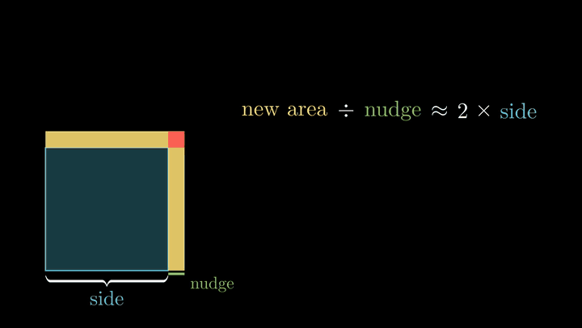
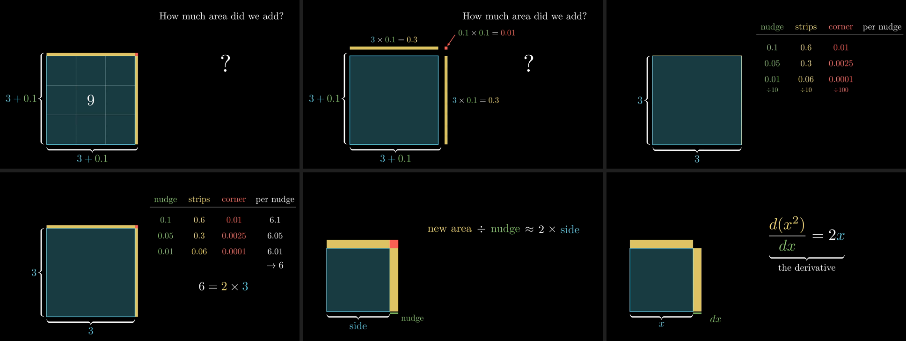

<div align="center">

# VideoExplain

**Turn research papers and concepts into narrated, intuition-first explainer videos.**

An agent skill for Claude Code, Codex, and OpenCode, rendered with Manim.

[](https://nodejs.org/)
[](https://www.manim.community/)
[](LICENSE)

[Demo](#demo) · [Quick start](#quick-start) · [Usage](#usage) · [How it works](#how-it-works) · [CLI](#cli)

</div>

Most generated explainers put a formula on screen in the first ten seconds and
then read the symbols aloud. VideoExplain teaches the way great math videos do,
in the spirit of 3Blue1Brown: start with a question worth caring about, play
with a small example you can check by eye, watch the picture make it click, and
only then give the idea its notation, one plain-language piece at a time.

## Demo

**How fast does a square grow?** A two-minute lesson on the derivative of x².

<p align="center">
  
</p>

The formula arrives last. Each plain-language phrase turns into its symbol, in
the equation and on the picture at the same moment, then the pieces rearrange
into the familiar fraction. Everything before that is built with real numbers:

<p align="center">
  
</p>

1. Grow a 3-by-3 square by 0.1. How much area did we add? Make a guess.
2. The new area is two strips (0.3 each) and one tiny corner (0.01).
3. Shrink the nudge: the strips shrink with it, the corner a hundred times faster.
4. Area gained per bit of nudge closes in on 6, which is two strips of length 3.
5. Say it in words: new area ÷ nudge ≈ 2 × side.
6. Name the pieces, and the derivative appears.

[Manim source](skills/explain-concept/assets/manim/square_derivative.py) ·
[Narration script](skills/explain-concept/assets/manim/project.example.json)

## Quick start

**1. Install the system libraries** Manim needs, plus ffmpeg:

```bash
brew install cairo pango pkg-config ffmpeg
```

On Linux, install cairo, pango, pkg-config, ffmpeg, and `espeak-ng` with your
package manager (see [Manim's installation guide](https://docs.manim.community/en/stable/installation.html)).

**2. Install Manim once, for every project:**

```bash
npx --yes --package=github:sunghoojung/videoexplain-skill \
  explain-concept setup
```

`setup` creates a shared Python environment at
`~/.local/share/explain-concept/venv` that every project, terminal, and agent
session finds automatically. It uses [uv](https://docs.astral.sh/uv/) when
available, otherwise Python 3.11+.

**3. Install LaTeX** for typeset formulas. [TinyTeX](https://yihui.org/tinytex/)
is small and needs no admin rights; MacTeX, BasicTeX, and TeX Live also work.
Then add the packages Manim uses:

```bash
tlmgr install standalone preview doublestroke ms setspace rsfs relsize \
  ragged2e fundus-calligra microtype wasysym physics dvisvgm jknapltx wasy \
  cm-super babel-english gnu-freefont mathastext cbfonts-fd
```

If `tlmgr` is not on your `PATH`, run it from TinyTeX's `bin` folder (for example `~/Library/TinyTeX/bin/universal-darwin/tlmgr`). The renderer finds TinyTeX and MacTeX even when they are not on your `PATH`.

**4. Install the skill** for your agent:

```bash
npx --yes --package=github:sunghoojung/videoexplain-skill \
  explain-concept install --agent claude --replace
```

Use `--agent codex` (the default) or `--agent opencode` for other agents, or
`--path` for a custom skills directory. Updates keep the previous installation
as a backup.

**5. Check everything:**

```bash
npx --yes --package=github:sunghoojung/videoexplain-skill \
  explain-concept doctor
```

`doctor` reports each dependency and prints the exact command for anything
missing.

## Usage

Ask your agent:

```text
Use $explain-concept to make a two-minute video explaining gradient descent.
```

```text
Use $explain-concept to turn this paper.pdf into a narrated explainer video.
```

```text
Use $explain-concept to explain why weight decay prevents overfitting,
for someone who knows basic calculus.
```

You get:

- `explainer.mp4`: the narrated video, with a subtitle track you can turn on.
- `explainer.srt`: subtitles timed to the speech.
- `lesson-plan.md`: the insight, hook question, worked example, and where the
  formula appears.
- The Manim source and `project.json`, so you can tweak and re-render.

On macOS, narration uses the built-in `say` voice; on Linux, `espeak-ng`. You
can ask for another installed voice or supply your own recorded narration.

## How it works

**The teaching method.** The skill tells the agent to follow these rules:

1. **Open with a question**, not a definition.
2. **Concrete before abstract.** Use the smallest example with real numbers, and
   let the viewer predict before the answer appears.
3. **Picture, then words, then symbols.** No formula until the viewer has seen
   the idea work.
4. **Build every formula one piece at a time.** Write it in plain words, swap
   each phrase for its symbol in matching colors, then plug the example back in.
5. **Narrate meaning, not notation.** Subtitles show what is spoken, so they
   never read math aloud.
6. **One idea per beat**, with something visible changing in each.
7. **End on the insight**, plus where it stops working.

**The pipeline.** The agent reads the source, writes a lesson plan, narration,
and Manim scenes. The CLI then:

1. **Lints the narration**, flagging beats that recite formulas, contain math
   symbols, or run too long.
2. **Measures the speech** for every beat before rendering anything.
3. **Renders each scene with Manim**, in parallel. Each narration beat is a
   `with self.beat():` block. If its animation finishes early, the picture holds
   until the speech ends. If it runs longer, a silent pause is added, so words
   are never cut off.
4. **Assembles the video** with narration and a subtitle track.
5. **Writes review frames**: the middle and end of every beat, plus a contact
   sheet of the whole lesson, so the agent can catch clipped labels, collisions,
   and garbled transitions before handing the video over.

Read more: [teaching method](skills/explain-concept/references/teaching.md) ·
[visual reasoning](skills/explain-concept/references/visual-reasoning.md) ·
[Manim production guide](skills/explain-concept/references/manim.md) ·
[papers](skills/explain-concept/references/paper.md)

## CLI

The agent runs these for you. Each command prints JSON on stdout and supports
`--help`. Below, `explain-concept` stands for
`npx --yes --package=github:sunghoojung/videoexplain-skill explain-concept`.

| Command | What it does |
| --- | --- |
| `doctor` | Checks Manim, LaTeX, ffmpeg, speech, and paper reading; prints fixes. |
| `setup` | Installs Manim and pypdf into the shared environment. |
| `install --agent claude` | Installs the skill for Claude Code, Codex, or OpenCode. |
| `lint --project project.json` | Flags narration that reads formulas aloud or runs long. |
| `render --project project.json --output video` | Renders the narrated video. |
| `ingest --paper paper.pdf --output paper-source` | Extracts page-indexed text and preview images from a PDF. |
| `guide --mode teaching` | Prints a skill reference (`concept`, `teaching`, `visual`, `manim`, `paper`, `remotion`). |

Useful `render` options:

- `--quality l|m|h`: 480p, 720p (default), or 1080p, all at 30 fps.
- `--scenes A,B`: render only some scenes while iterating.
- `--voice <name>`: use a different local voice.
- `--python <path>`: use a specific Python with Manim.

Each render needs a new or empty output directory. See the
[Manim guide](skills/explain-concept/references/manim.md) for the project
format, beat timing, and supplied audio.

<details>
<summary><strong>Alternative engine: React and Remotion</strong></summary>

A project whose `source` is a `.jsx` or `.tsx` file renders with
[Remotion](https://www.remotion.dev/) instead of Manim. It needs only Node.js and
ffmpeg, but it has no LaTeX typesetting, so lessons with equations look and
teach better in Manim.

**A matrix moves the whole plane**, a 54-second example built with Remotion:

https://github.com/user-attachments/assets/a7cc3739-8b2c-47f2-b9e9-79a04b4e8f7c

[Animation source](skills/explain-concept/assets/remotion/scenes.example.jsx) ·
[Narration script](skills/explain-concept/assets/remotion/project.example.json) ·
[Remotion guide](skills/explain-concept/references/remotion.md)

</details>

<details>
<summary><strong>Local development</strong></summary>

Render the included example from a checkout:

```bash
npm ci
node skills/explain-concept/scripts/explain-concept.mjs render \
  --project skills/explain-concept/assets/manim/project.example.json \
  --output video --quality l
```

The skill lives in `skills/explain-concept/`:

- `SKILL.md`: the instructions the agent follows.
- `references/`: the teaching method, visual reasoning, Manim and Remotion
  guides, and paper reading.
- `assets/manim/`: the `explain_kit` narration-sync module and the example
  lesson.
- `assets/remotion/`: the alternative engine's wrapper and example.
- `scripts/`: the CLI, renderer, and narration lint.

</details>

## Credits and license

Adapted from [PaperExplainAgent](https://github.com/mihirballari/PaperExplainAgent).
The teaching approach is inspired by [3Blue1Brown](https://www.3blue1brown.com/about/);
lessons are original and not affiliated with it.

Skill code is [MIT licensed](LICENSE). [Manim Community](https://www.manim.community/)
is MIT licensed; [Remotion has separate license terms](https://www.remotion.dev/license).
See [provenance](skills/explain-concept/references/provenance.md).
